# Worms Garden Adventure 3D

A first-person / third-person 3D remake of the 2D maze game *Worms Garden Adventure*
that was developed during Labs 6-8 of **GEIAL31L-B2a Computer Graphics Programming**
(University of Miskolc, Institute of Information Science).

* **Student:** Chen Zizheng (NEPTUN: EO8UMY)
* **Course:** GEIAL31L-B2a Computer Graphics Programming, University of Miskolc
* **Version:** 1.0 (2026/27 semester 1)
* **Submission video:** `video/worm_garden_demo.mp4` (3:00)

Everything on screen is rasterised by hand-written **NumPy software renderer**:
there is no OpenGL, no Pygame drawing primitive and no 3D library anywhere in the
pipeline. Pygame is used only to open a window, read the keyboard and blit the final
RGB buffer. The renderer implements perspective / orthographic projection, near-plane
clipping, back-face culling, a z-buffer, per-pixel lighting, texture mapping with
perspective-correct interpolation, bilinear filtering, depth fog and screen-space bloom.
The art direction is a **night garden**: deep blue sky with stars and a moon halo, stone
walls lit by cold moonlight, a glowing neon-green worm, and a vignette that keeps the eye
in the middle of the frame.

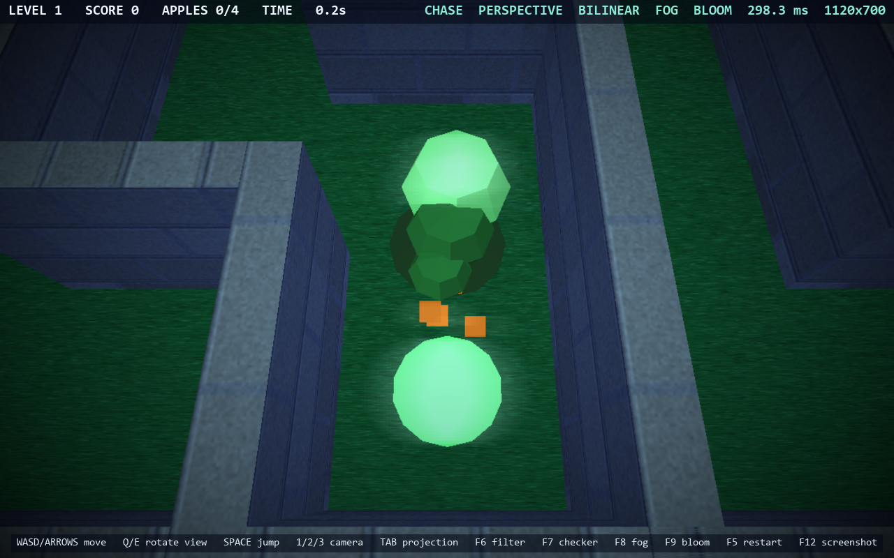

---

## Table of contents

1. [What the game contains](#what-the-game-contains)
2. [Install and run](#install-and-run)
3. [Controls](#controls)
4. [Rendering pipeline](#rendering-pipeline)
5. [Mapping to the assignment requirements](#mapping-to-the-assignment-requirements)
6. [Part B extensions](#part-b-extensions)
7. [Performance](#performance)
8. [Tests](#tests)
9. [Project structure](#project-structure)
10. [Known limitations](#known-limitations)
11. [External assets and references](#external-assets-and-references)

---

## What the game contains

* A procedurally generated **23 x 15 maze** (recursive backtracker), rebuilt for every level.
* A controllable **worm** built from three shaded spheres, with a squash-and-stretch walk animation.
* **Nine water holes** that reset the player, **four apples / medals** (3 x silver = 50, 1 x gold = 100),
  **three birds** that patrol the corridors, and a finish flag that only opens once all medals are collected.
  There are no checkpoints: the start flag is only the spawn point, exactly as in the 2D original. When a
  water hole, a bird or the closed finish flag sends you back, the HUD says which one it was, and a
  1.2 s spawn guard stops a passing bird from hitting you again before you can move.
* **Jumping** with gravity, wall sliding, and a 3D **spark particle system** (pool capped at 250).
* **Three camera presets** (chase, top-down, overview) and **P / 1 / 2 / 3 keys** to switch between
  perspective and orthographic projection at any time.
* HUD with level, score, medals, timer, current camera/projection/filter, FPS and internal resolution.
* Three Part B extensions: **bilinear texture filtering**, **z-buffer depth fog** and
  **screen-space bloom** (bright pass + separable box blur).

| | |
|---|---|
|  | 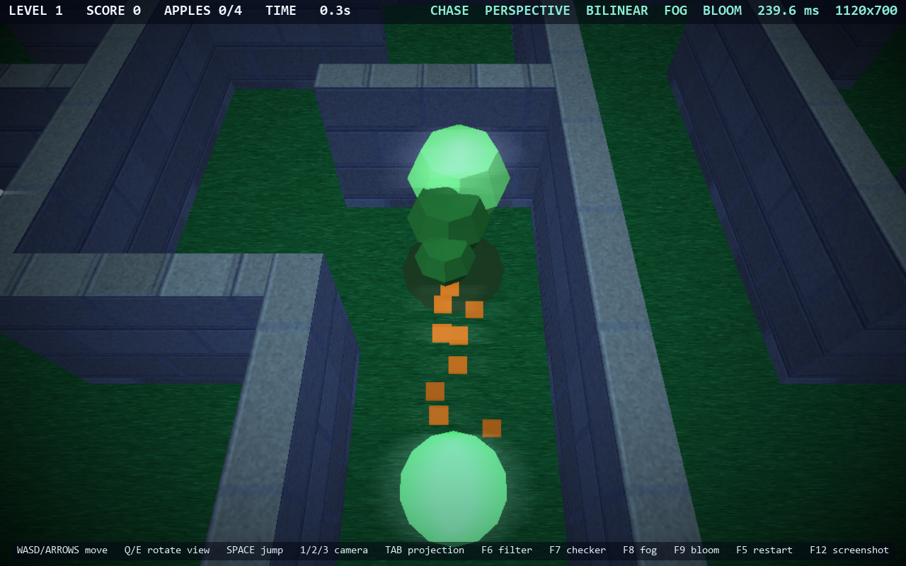 |
| Chase camera, perspective, nearest sampling | Jumping, particles, view from behind |
| 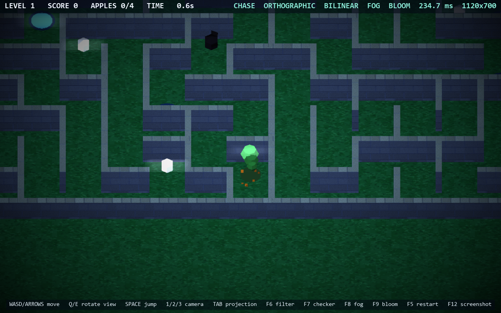 | 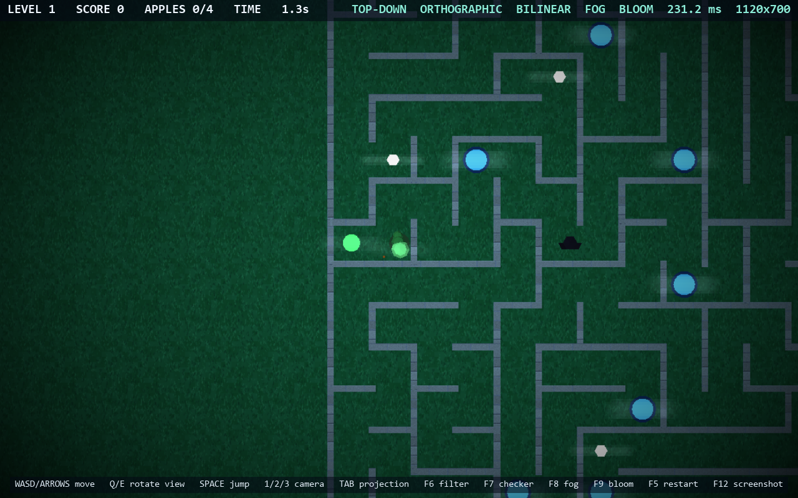 |
| Chase camera, orthographic projection | Top-down preset, orthographic projection |
| 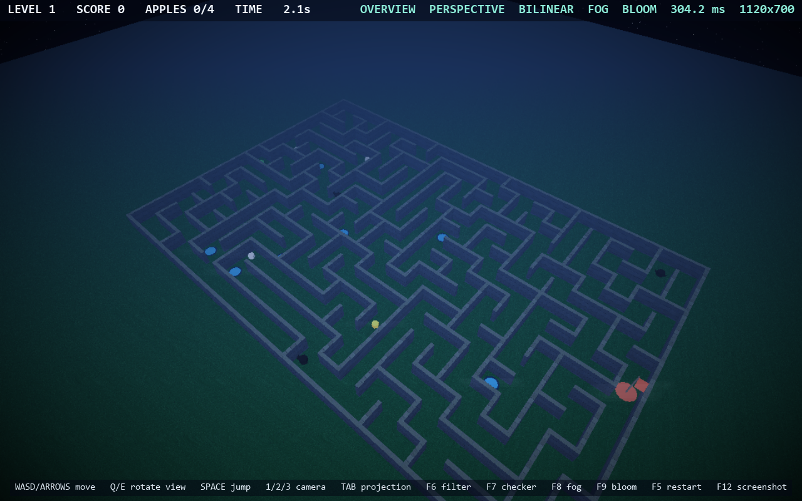 | 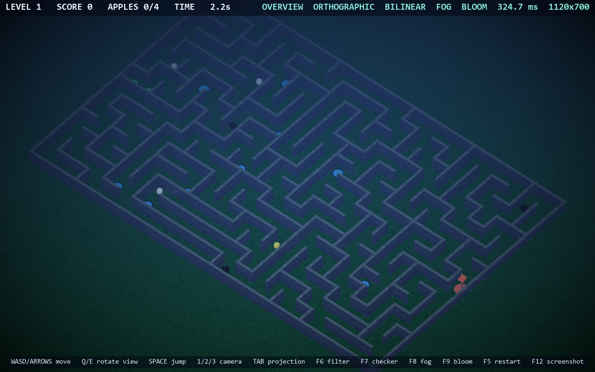 |
| Overview, perspective, depth fog on | Overview, orthographic projection |
| 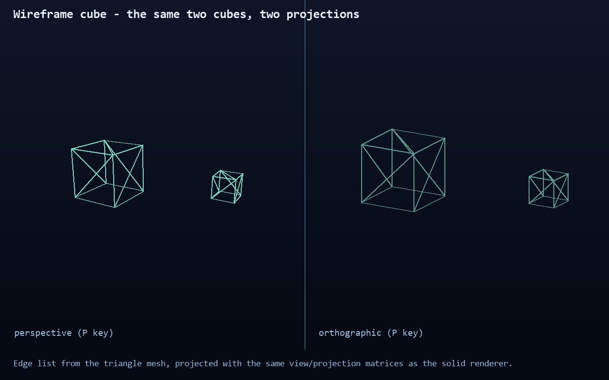 | 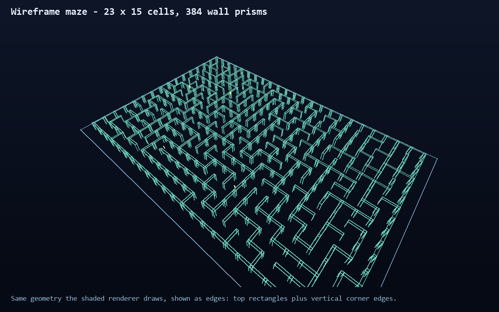 |
| Wireframe cube: perspective (left) vs orthographic (right), same camera | Wireframe maze: 384 wall prisms shown as edges |

---

## Install and run

Requirements: Python 3.10+ (developed and tested on 3.12), numpy, Pillow, pygame(-ce).

```bash
pip install -r requirements.txt

python main.py            # play
python main.py --bench    # render-only benchmark with live FPS counter
python main.py --quality 2  # start at the 1120x700 internal resolution
```

On Windows you can also double-click `run.bat`.

Screenshots are written to `screenshots/` with **F12**.

Regenerating the textures / screenshots / benchmark numbers:

```bash
python make_textures.py        # writes textures/grass.png, stone.png, checker.png
python make_screenshots.py     # regenerates all report screenshots + comparison sheets
python bench_render.py 20 --md perf.md   # writes bench_results.json + a markdown table
python run_tests.py -v         # 55 unit tests, no display required
```

The 3-minute demonstration video (`video/worm_garden_demo.mp4`) is produced by the same
headless renderer, so it can be regenerated on a machine without a display or a sound card:

```bash
python make_video.py --ffmpeg /path/to/ffmpeg   # 1280x800, 20 fps, H.264
```

All of those scripts work headless (they only need numpy + Pillow); set
`SDL_VIDEODRIVER=dummy` if you run the screenshot script on a machine without a display.

---

## Controls

| Key | Action |
|---|---|
| `W A S D` / arrow keys | Move (screen-relative: up always walks into the screen, right always walks screen-right) |
| `Q` / `E` | Rotate the view left / right |
| `Space` | Jump |
| `1` / `2` / `3` | Camera preset: chase / top-down / overview |
| `P` or `Tab` | Toggle perspective <-> orthographic projection |
| `B` or `F6` | Toggle texture filtering: nearest <-> bilinear |
| `T` or `F7` | Swap grass/stone textures for a checkerboard (aliasing demo) |
| `F` or `F8` | Toggle the depth fog on/off (Part B extension B) |
| `G` or `F9` | Toggle screen-space bloom on/off (Part B extension C) |
| `R` or `F5` | Restart the current run |
| `F1` / `F2` / `F3` | Internal render resolution 480x300 / 800x500 / 1120x700 |
| `F12` | Save a screenshot |
| Mouse drag | Orbit the camera (yaw / pitch) |
| `Esc` | Quit |

Movement is **screen-relative**, not world-relative: the key vector is projected onto the
ground using the camera's own view matrix (see `Camera.ground_basis()`), so the arrow keys keep
their on-screen meaning in every camera preset and after any orbit. The chase camera follows the
worm's position but never rotates on its own - pressing a strafe key no longer spins the view
(that was the bug where "left" sometimes looked like "right"). Rotate the view with `Q`/`E` or
with the mouse.

The window is always 1280x800; the 3D scene is rendered into an off-screen buffer and
smooth-scaled to the window, so the internal resolution is independent of the window size.
The game starts at 480x300 (`F1`) because the rasteriser is CPU-bound; `F2`/`F3` are meant
for screenshots. Every letter key has an IME-proof alias (`Tab`, `F5`-`F8`): the game also
calls `pygame.key.stop_text_input()` at start-up so that a Chinese/Japanese input method
cannot swallow `W A S D`, `P`, `B`, `T`, `F` or `R`.

---

## Rendering pipeline

```
model geometry (numpy arrays: verts, triangle indices, per-face colour, uv)
        |
        v
world -> view  (look_at matrix, column vectors, M @ p)
        |
        v
near-plane clipping in *camera space* (Sutherland-Hodgman against z = -near,
                                       uv attributes interpolated per vertex)
        |
        v
projection (perspective: x' = x / (tan(fov/2) * aspect * -z), z' from the near/far mapping)
           (orthographic: x' = x / (aspect * ortho_h/2), no division)
        |
        v
screen-space triangle setup: integer bounding box, edge functions,
per-pixel barycentric coordinates, depth test, depth write
        |
        v
shading: ambient + two-directional Lambert (key light + fill light), then
texture sample (nearest or bilinear) with perspective-correct u/v recovery
        |
        v
full-screen depth-fog pass, `to_image()` -> uint8 RGB -> pygame blit
```

Key implementation details:

* **Matrices** are 4x4 float32, column-vector convention (`M @ p`), row-major storage.
  `look_at` builds the view matrix from `right = normalize(cross(forward, up))`.
* **Near clipping** happens before the perspective divide, so vertices behind the camera
  can never produce garbage. A triangle that crosses the plane is split into 1-2 triangles
  and the interpolation parameter of the crossing edge is reused for uv.
* **Z-buffer** stores the post-projection NDC depth (smaller = closer). The rasteriser
  computes one depth per pixel by barycentric interpolation, so it is correct for
  non-planar-per-pixel triangles and does not depend on submission order.
* **Back-face culling** uses the sign of the screen-space signed area (winding order),
  which is one multiply per triangle; two-sided meshes (water discs, particles) can opt out.
* **Lighting**: `shade = ambient + (1 - ambient) * clipsum(0.8 * max(0, n.L) + 0.34 * max(0, n.Lfill))`,
  with the face normal computed once per triangle. Wall tops receive a slightly different
  tint so the maze reads clearly from above.
* **Textures** are 128x128 PNGs generated procedurally with Pillow (grass with 1100 random
  blades, stone as a brick pattern with mortar lines and per-brick random tone, checkerboard
  for the aliasing experiment). Ground and wall are the only textured materials - the rest is
  flat shaded, which keeps the fill rate acceptable for a pure-Python rasteriser.
* **Perspective-correct texturing**: per-pixel we interpolate `u/z`, `v/z` and `1/z`
  and divide, rather than interpolating u/v linearly (which would show the classic
  swimming/affine distortion on the floor). In orthographic mode `1/z` is constant and the
  division is skipped (`perspective=False`).
* **Fog** is a screen-space pass over the z-buffer: NDC depth is reversed back to a view-space
  distance with the inverse of the projection mapping, the pixel is then lerped towards the
  fog colour with `f = clamp((d - start) / (end - start))`. Sky pixels (infinite depth) are
  left untouched.
* **Bloom** is the last image-processing pass: the frame is averaged down to 1/4 resolution,
  pixels above a brightness threshold are kept, the result is blurred twice with a separable
  box filter built from prefix sums (cost independent of radius), upscaled and added back.
  Only the worm, the medals, the water and the moon exceed the threshold, so the dark
  corridors are not lifted. A slight channel gain (colour grade) and a radial vignette are
  applied after it, which is what produces the cool night-garden look.

---

## Mapping to the assignment requirements

| Requirement (handbook) | Where |
|---|---|
| 3D maze made of ground, walls, worm, birds, apples, water, start/finish | `scene.py`, `world.py` |
| Movable camera + 3 presets | `camera.py` presets 1/2/3 |
| Perspective vs orthographic (P key) | `camera.toggle_projection`, `math3d.perspective`/`orthographic` |
| Filled triangles + depth buffer (no painter's algorithm) | `raster.Renderer._raster_tri` |
| Near-plane clipping | `raster.clip_near` |
| Ambient + diffuse light, at least one Pillow texture | `raster.draw_mesh`, `assets.make_grass`/`make_stone` |
| Keeping the 2D gameplay: procedural maze, collision, jump, score, timer | `world.py` |
| One 3D animation and one 3D particle effect | worm squash/walk in `scene.build_dynamic`, sparks + billboards |
| Part B: at least two extensions, one graphics/image-processing | bilinear filtering (A) + depth fog (B) + bloom (C) |

---

## Part B extensions

### A. Bilinear texture filtering (image processing)

*Nearest* samples the texel containing (u, v); *bilinear* samples the four surrounding
texels and lerps by the fractional part of (u, v):

```
s = texel[floor(v)][floor(u)]             t = texel[floor(v)][floor(u) + 1]
p = texel[floor(v) + 1][floor(u)]         q = texel[floor(v) + 1][floor(u) + 1]
c = lerp(lerp(s, t, fu), lerp(p, q, fu), fv)
```

The toggle is the **B** key (HUD shows `NEAREST`/`BILINEAR`), and both paths are
covered by the unit test suite (`tests/test_raster.py::TestTexturedRaster`).

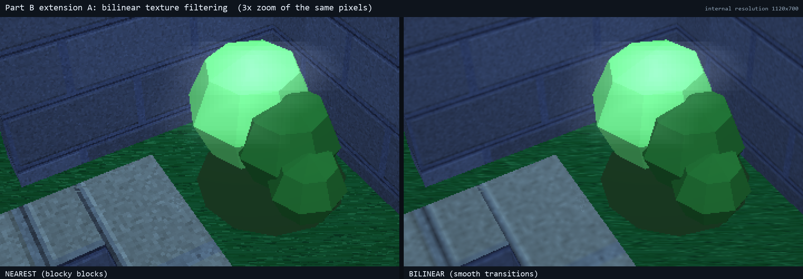

With the high-frequency checkerboard (**T** key) the difference becomes an aliasing
demonstration: nearest-neighbour produces moire patterns, bilinear softens them but cannot
remove them, because the real fix is mip-mapping - see *Known limitations*.

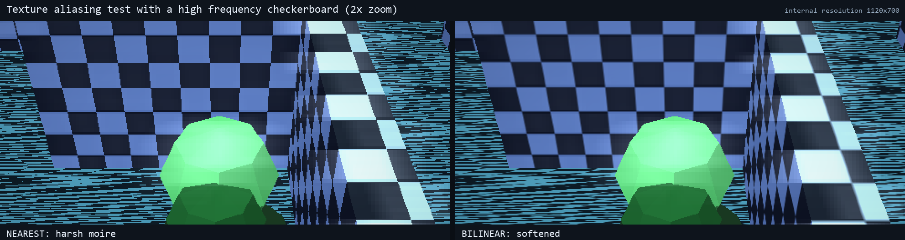

### B. Depth fog from the z-buffer

The renderer already has per-pixel linear depth in the z-buffer, so fog needs no extra
geometry: after the scene is rasterised, each pixel is converted back to a view-space
distance and blended towards `FOG_COLOR`. It makes the overview shot readable (distant
maze fades into the sky) and hides the edge of the ground plane.

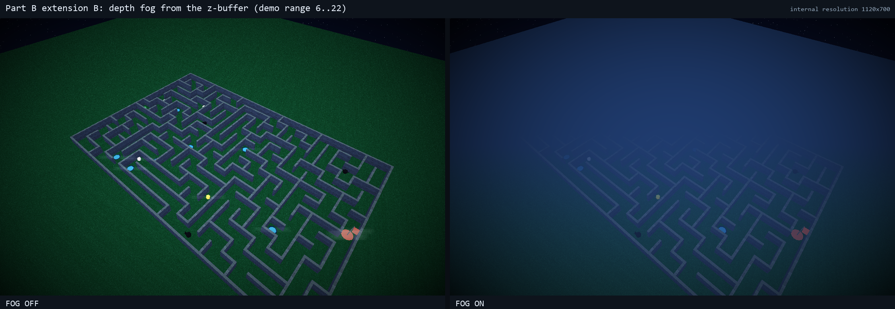

`FOG_ENABLED`, `FOG_START` (7.0) and `FOG_END` (34.0) live in `config.py`; the comparison
sheet uses a tighter 6..22 range so the effect is visible in a static image.

### C. Screen-space bloom (image processing)

The night scene wants light to spill out of the bright objects. After the fog pass the frame
is averaged down to 1/4 resolution, pixels brighter than `BLOOM_THRESHOLD` (0.50) are
extracted, the small image is blurred with two separable box filters (prefix sums, so the
cost does not depend on the radius), upscaled with a repeat and added back with
`BLOOM_STRENGTH` (0.70). The sky gradient never reaches the threshold, so only the worm,
medals, water and moon glow - and because the pass runs on a quarter-resolution buffer it
costs about 15 ms per frame at 800x500 and about 3 ms at 480x300.

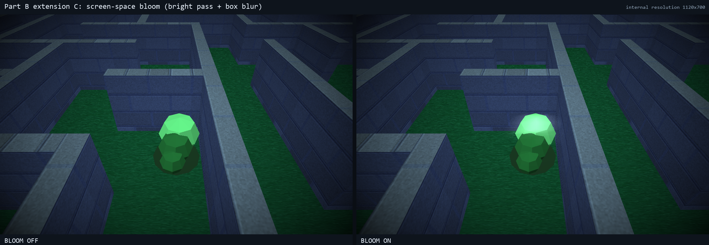

The toggle is **G** / **F9**; the HUD shows `BLOOM` or `-`.

---

## Performance

Measured with `python bench_render.py 20` on the development machine
(AMD64, Windows 11; Python 3.13.13, numpy 2.5.1, Pillow 12.3.0).
Scene: seed 7, level 1, 23x15 maze, 2498 triangles submitted per frame.
The numbers below are `draw_world()` only (rasteriser + fog + bloom + grade + vignette); the
running game adds about 5-8 ms on top for the HUD, the colour-buffer upload and the 1280x800
upscale, which is why `python main.py --bench` reports ~22 fps at the default 480x300
instead of the 29 fps here.
The software renderer is **single-threaded** - it is a CPU rasteriser written in NumPy.

| Camera / projection | Internal resolution | Triangles submitted | Triangles drawn | Mean ms | FPS |
|---|---|---|---|---|---|
| Chase / perspective | 480x300 | 2498 | 295 | 34.5 | 28.9 |
| Chase / orthographic | 480x300 | 2498 | 479 | 38.9 | 25.7 |
| Top-down / perspective | 480x300 | 2498 | 645 | 47.0 | 21.3 |
| Top-down / orthographic | 480x300 | 2498 | 554 | 44.5 | 22.5 |
| Overview / perspective | 480x300 | 2498 | 1374 | 85.9 | 11.6 |
| Overview / orthographic | 480x300 | 2498 | 1477 | 87.2 | 11.5 |
| Chase / perspective | 800x500 | 2498 | 299 | 73.8 | 13.6 |
| Chase / orthographic | 800x500 | 2498 | 491 | 74.9 | 13.4 |
| Top-down / perspective | 800x500 | 2498 | 658 | 88.8 | 11.3 |
| Top-down / orthographic | 800x500 | 2498 | 566 | 82.8 | 12.1 |
| Overview / perspective | 800x500 | 2498 | 1512 | 130.4 | 7.7 |
| Overview / orthographic | 800x500 | 2498 | 1574 | 134.8 | 7.4 |
| Chase / perspective | 1120x700 | 2498 | 298 | 136.5 | 7.3 |
| Chase / orthographic | 1120x700 | 2498 | 491 | 131.5 | 7.6 |
| Top-down / perspective | 1120x700 | 2498 | 660 | 140.1 | 7.1 |
| Top-down / orthographic | 1120x700 | 2498 | 569 | 136.1 | 7.3 |
| Overview / perspective | 1120x700 | 2498 | 1553 | 193.8 | 5.2 |
| Overview / orthographic | 1120x700 | 2498 | 1591 | 202.0 | 5.0 |

What the optional features cost, measured on the same frame at 800x500 (chase camera,
perspective, everything switched on one at a time):

| Feature set | Mean ms | FPS |
|---|---|---|
| flat, no fog, no bloom | 51.1 | 19.6 |
| + depth fog | 57.7 | 17.3 |
| + fog + bloom | 71.4 | 14.0 |
| + fog + bloom + bilinear | 115.2 | 8.7 |

So the depth-fog pass costs about 7 ms, bloom about 14 ms, and switching the textured
fill path to bilinear adds roughly 60% on top of everything else.

Full data (including p95 latencies) is in `bench_results.json`. The costs are all **fill-rate bound**, which is why the chase camera
(most of the screen is a handful of near walls) stays interactive while the overview shot
(every wall of the maze is visible) is the worst case. Bilinear filtering roughly adds
60-100% to the textured fill cost.

Performance measures that are already in the renderer:

* static maze geometry is merged (173 wall runs -> one mesh) and cached per level,
* the near plane is at 0.1 so the giant ground quad can be clipped cheaply,
* per-triangle bounding boxes are computed once and reused by both raster paths,
* screen-space coordinates and texture gather indices are pre-computed with
  `np.arange`/broadcast arrays instead of `meshgrid`,
* wall tops and the ground are the only textured materials.

---

## Tests

```bash
python run_tests.py -v
```

55 unit tests, no display or pygame needed:

| File | What it covers |
|---|---|
| `tests/test_math3d.py` | matrix construction, look_at, projection mappings, near/far behaviour |
| `tests/test_geometry.py` | vertex/face counts, outward winding of boxes and spheres, uv generation, transforms |
| `tests/test_raster.py` | screen mapping, near-plane clipping (incl. uv interpolation), z-buffer ordering, back-face culling, nearest vs bilinear, fog distance inversion |
| `tests/test_world.py` | maze connectivity and closed border, wall collision and sliding, jump apex/air-time from the analytic solution, medal scoring, water reset, finish conditions, particle cap and expiry, restart |
| `tests/test_assets.py` | textures exist / load / are in range, power-of-two size, grass vs stone colour statistics, checkerboard values |

---

## Project structure

```
worm_garden_3d/
├── main.py              # window, input, HUD, game loop (pygame only for the window)
├── config.py            # all tunable constants (maze size, physics, camera, fog, ...)
├── math3d.py            # matrices: translation/scaling/rotation, perspective, orthographic, look_at
├── geometry.py          # mesh builders: box, quad, disc, cylinder, sphere, merge, transform
├── raster.py            # the software renderer: clipping, projection, z-buffer, lighting, texturing, fog
├── world.py             # game rules: maze generation, collision, player, medals, enemies, particles
├── scene.py             # turns the world into meshes, procedural animation of dynamic objects
├── camera.py            # 3 camera presets + orbit + projection switching
├── render_scene.py      # per-frame entry point: static cache + dynamic meshes + fog
├── assets.py            # procedural texture generation / loading
├── make_textures.py     # writes the texture PNGs
├── make_screenshots.py  # headless script that produces every screenshot in this README
├── make_wireframe.py    # headless script for the two wireframe evidence renders
├── make_video.py        # headless script that renders the demonstration video
├── bench_render.py      # performance benchmark (writes bench_results.json)
├── run_tests.py         # unittest entry point
├── run.bat              # Windows launcher
├── requirements.txt
├── tests/               # 55 unit tests
├── textures/            # grass.png, stone.png, checker.png (generated, 128x128)
└── screenshots/         # report screenshots + comparisons/
```

---

## Known limitations

* **No mip-mapping / anisotropic filtering.** Bilinear filtering only reduces aliasing;
  minification of the checkerboard still aliases badly, and the floor shows shimmering at
  grazing angles. The proper fix is a mip pyramid with trilinear selection.
* **Single-threaded rasteriser.** Triangles are processed sequentially; a tile-based
  parallel version with `multiprocessing` or a numba kernel would be the next big win.
* **No shadow mapping.** Shading is per-triangle flat Lambert plus two fixed lights, so
  curved objects (worm, apples, birds) look faceted. Per-vertex normals / Gouraud shading
  or a Phong model would smooth them out.
* **Depth fog is applied after the texture lookup**, so it is a post-process on the colour
  buffer rather than part of the shading equation. It is also linear in view distance, not
  exponential (an exponential-squared curve looks more natural outdoors).
* **Bloom is a fixed-threshold post-process.** The pipeline is not HDR: the bright pass
  saturates at 1.0 and the threshold is a constant, so the brightest areas lose contrast
  instead of rolling off. An HDR buffer with an exposure curve would handle highlights
  better.
* **The ground plane is finite** (26 units of margin around the maze). From unusual camera
  angles you can see its edge, which the fog partially hides.
* The game itself is a single level per run: reaching the flag with all four medals generates
  the next maze, but there is no persistent progression or high-score save.

---

## External assets and references

* **Code**: all Python in this repository was written for this assignment. The 2D starter
  project (`Start2Dto3D.py`, distributed with the handout) was used as the source of the
  gameplay rules (maze cell size, jump velocity, gravity, particle cap, medal values) but no
  2D drawing code was reused - the whole 3D renderer is new.
* **Textures**: generated at runtime by `assets.py` with Pillow; no external image files,
  no third-party art assets.
* **Libraries**: numpy (arrays/vectorisation), Pillow (texture generation, PNG output),
  pygame-ce (window, input, blitting). No 3D engine, no GL/DirectX code.
* **References**: the *Worms Garden Adventure 3D Student Project Handbook (GEIAL31L-B2a)*,
  the Lab 6/7/8 handouts (game loop, 2D vectors/kinematics, input mapping and particles),
  and standard real-time rendering material for the projection/clipping/z-buffer math.
